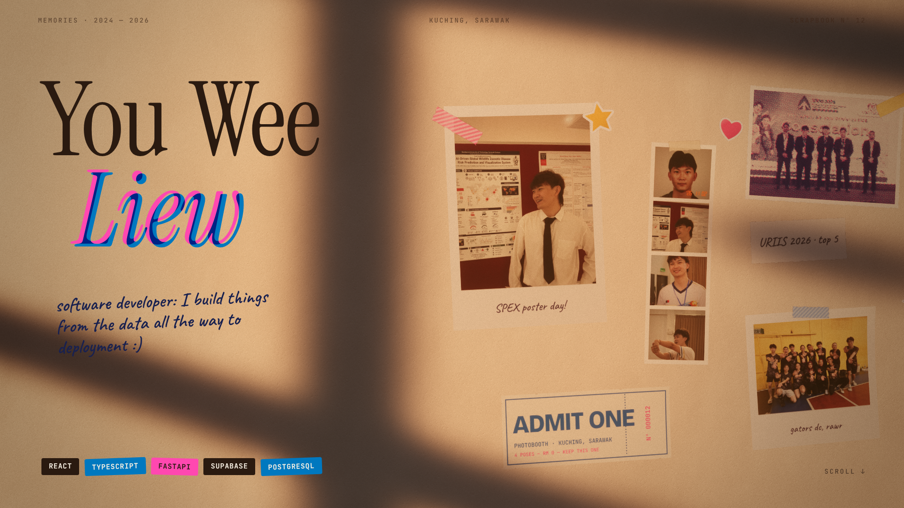

# Art bible: golden-hour scrapbook

The user picked style frame B (golden hour) mixed with C (cut & paste).
`art-bible-frame.png` is the bar for the whole site: every element is judged
against it, and against the reference sites once they are reachable.

## One line

Late-afternoon sun through a window, falling across a plaster wall where
someone has taped up their memories, scrapbook-style.

## Palette

| Role | Hex | Notes |
|---|---|---|
| Wall, lit | `#ece0cd` | Lime plaster, warm; the sun pushes it toward `#f3c99a` |
| Wall, shade | `#6b4a3a` | Window-bar shadows; never pure black |
| Ink (display type) | `#2a1a10` | Warm near-black |
| Riso pink | `#ff48b0` | Fluorescent spot ink: accents, "Liew", washi tape, hearts |
| Riso blue | `#0078bf` | Second spot ink: misregistration, tape, chips, links |
| Ballpoint blue | `#1f2c66` | All handwriting |
| Sticker yellow | `#ffc83d` | Stars only |
| Paper | `#f8f5ee` / `#fbf6ea` | Instant photo stock, notes |
| Terracotta | `#a8461f` | Rare secondary accent |

Grade (pipeline look): bloom 0.05, halation 0.16, exposure 1.06, saturation 0.98,
contrast 1.04, lift [0.018, 0.012, 0.004], gain [1.02, 0.995, 0.95], grain 0.045,
vignette 0.3. Sun `#ffc28a`, sky fill `#b5c6e4` over ground `#7a5a44`.

## Type

| Use | Face | Setting |
|---|---|---|
| Display (name, chapter titles) | Instrument Serif | 11.4vw desktop, line-height 0.86, tracking -0.012em; italic word in riso pink with a riso-blue copy offset (0.45vw, 0.3vw), both `mix-blend-mode: multiply` |
| Handwriting (notes, captions) | Caveat 600 | Ballpoint blue, rotated -1° to -3°, never more than ~12 words per note |
| Doodles, stickers' words | Gochi Hand | Sparingly; riso blue |
| Labels, meta, chrome | JetBrains Mono 500-700 | Uppercase, tracking 0.18-0.2em, 0.72vw |
| Body copy | Inter Tight 400 | 1.1-1.3vw desktop, 16-17px phone, line-height 1.4 |
| Ticket / stamp headlines | Bricolage Grotesque 800, wdth 75 | Only on printed ephemera |

All fonts are vendored in `site/assets/fonts/` (OFL).

## Materials

- **Plaster wall:** procedural colour + normal map (`paper.js` `plaster`), roughness 0.94.
- **Instant photos:** thin border, deep bottom lip with a Caveat caption, semi-gloss (clearcoat 0.35), slight curl and a lifted corner.
- **Photobooth strip:** four frames, warm colour on the wall, black and white for the flash moment. Orange date imprint on frame one.
- **Riso prints:** two-ink halftone (pink 15°, blue 75°), misregistration of a few pixels, rough scissor-cut edge, matte.
- **Tape:** masking tape (cream, translucent) or washi (pink, blue, yellow with white stripes); torn ends; it casts no shadow.
- **Stickers:** puffy, white die-cut border, glossy; star, heart, sparkle only.
- **Ticket stub:** card stock, riso blue, perforation line, pink serial.
- **Label chips:** label-maker tape for skills: ink, riso blue or riso pink with off-white mono text, small random tilt.

## Light

- One key: the sun as a spot light with a window gobo (mullions and leaves), warm, soft-edged, raking from upper left.
- One fill: cool hemisphere sky light. Shadows are cool, light is warm.
- Light may drift slowly with time and pan with scroll. It never strobes.
- Text sits in light. If a chapter's composition puts copy in shadow, move the light, not the copy.

## Motion

- Cinematic. One damped scroll value drives DOM and WebGL. No independent timelines.
- Paper moves like paper: slow settle, slight overshoot only when something lands (a strip taped up, a sticker slapped on).
- Camera moves are dollies and slow pushes, never whips. Keys far apart; screen speed checked numerically.
- Pins ease in and out over at least 0.1 viewport heights.
- The signature moment is the flash: countdown, HDR white flash, a fresh strip prints and develops frame by frame, then gets taped to the wall.

## Composition rules

- Name and copy live in the left 40% on desktop. The memories cluster right of centre.
- At most five pieces of paper in view at once, plus up to three stickers.
- Every photo is real: the user's own photos and project screenshots. No generated people, no stock.
- No third-party brand logos as decoration (the Bar project's beer brands stay off its card).

## Assets

No generated images: the image budget is $0, so there are no prompts to list.
Every texture is procedural (see `site/js/lib/paper.js`, `prints.js`) or one of
the user's own photos and screenshots.

| Asset | Source |
|---|---|
| `site/assets/img/portrait.jpg` | User's resume PDF (embedded photo) |
| `site/assets/img/memories/*.jpg` | User's photos, uploaded 2026-11-02 (resized, metadata stripped, two cropped for privacy) |
| `site/assets/img/projects/spex-*.jpg` | `Uwe1209/spex002` docs and map-style images |
| `site/assets/img/projects/kacha-*.jpg` | `Uwe1209/kacha` client/public |
| `site/assets/img/projects/herbarium.jpg` | `Uwe1209/PlantBiodiversityProject` screenshot |
| `site/assets/img/projects/aws-architecture.jpg` | `Uwe1209/CloudComputingArchitectureProject` |
| Plaster, paper, tape, stickers, halftones, gobo | Procedural, baked once at load |
